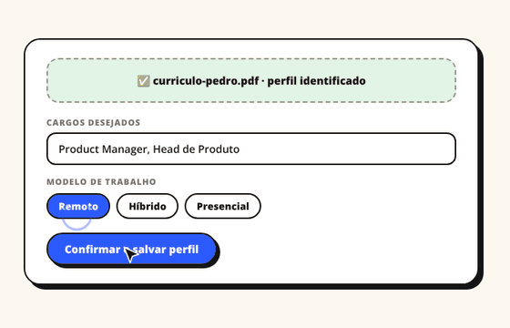
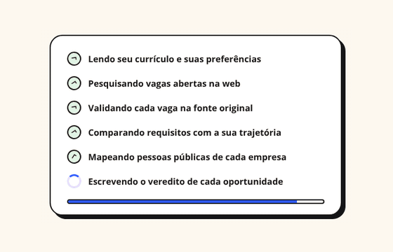
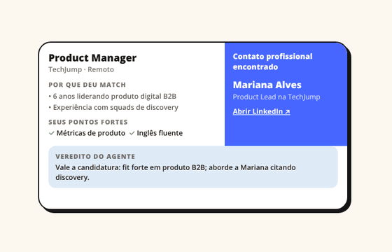
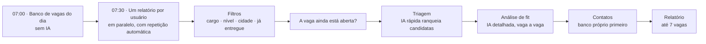

  

<h3 align="center">Seu relatório diário de vagas, com a pessoa certa pra abordar. 🔎 → 🤝</h3>

  O <b>HEADHUNTR</b> é um agente de IA que procura vagas por você, analisa o fit de cada uma 
  e entrega, todo dia de manhã, um relatório pronto, com <b>quem abordar</b> nas melhores vagas.

  

Esta é a vitrine pública do projeto. O código-fonte é privado.

---

  

Do currículo ao relatório: o perfil é montado a partir do CV, o agente trabalha e o relatório chega com a análise de cada vaga e o contato para abordar.

<table>
  <tr>
    <td align="center" width="33%"><h2>20 mil+</h2>vagas lidas todos os dias, em 8 fontes e 60+ sites de carreira</td>
    <td align="center" width="33%"><h2>1.200+</h2>contatos de RH e liderança em 700+ empresas, num banco que cresce a cada relatório</td>
    <td align="center" width="33%"><h2>50%</h2>dos usuários do piloto marcaram entrevista na primeira semana, pelos contatos entregues</td>
  </tr>
</table>

## O problema

Quem procura emprego passa horas em sites de vagas, se candidata às cegas e quase nunca fala com uma pessoa. Achar vagas é fácil. O difícil é saber **quais realmente combinam** com a sua trajetória e **quem, dentro da empresa, vale a pena procurar**.

## O produto

O HEADHUNTR não é um site de vagas: o usuário não busca nada. Ele envia o currículo uma vez e, a partir daí, um agente trabalha por ele todos os dias.

<table>
  <tr>
    <td align="center" width="33%">
       
      <b>1 · CONTEXTO</b> 
      O currículo vira um perfil: cargos-alvo, nível, cidade e modelo de trabalho.
    </td>
    <td align="center" width="33%">
       
      <b>2 · O AGENTE TRABALHA</b> 
      Busca, confere se a vaga está aberta, compara com a trajetória e mapeia pessoas.
    </td>
    <td align="center" width="33%">
       
      <b>3 · RELATÓRIO COM QUEM ABORDAR</b> 
      Até 7 vagas por dia, com nota de fit, pontos fortes, gaps, veredito e o contato.
    </td>
  </tr>
</table>

> Em um dos relatórios do piloto, o contato indicado era exatamente a recrutadora que já estava entrevistando aquele usuário para a mesma vaga.

## Meu papel

Concebi e conduzo o HEADHUNTR de ponta a ponta, como fundador solo: a ideia, o posicionamento, a marca, a experiência e, principalmente, **o desenho do motor**: como as vagas são encontradas, filtradas, analisadas e entregues, com custo de centavos por relatório.

Também opero o piloto com usuários reais: acompanho cada rodada diária, transformo cada falha em regra do sistema e revisei pessoalmente mais de mil contatos que formam o banco de contatos. A implementação foi feita com o **Lovable** e o **Claude** como pares de engenharia, sob a minha direção. A arquitetura, as regras e cada decisão de produto são minhas.

## Como o agente funciona

- **Um banco de vagas por dia, para todos.** As fontes são lidas uma única vez de manhã, em centenas de partes pequenas e independentes. Os relatórios leem esse banco pronto: 100 usuários não significam 100 buscas.
- **Etapas pequenas, que se recuperam sozinhas.** Cada relatório anda em passos curtos e salva o estado a cada passo. Uma falha custa só uma nova tentativa, nunca o relatório do dia.
- **100% automático.** Do banco de vagas à entrega, tudo roda pelo próprio servidor, todos os dias, sem ninguém apertar botão.

## Decisões de produto

- **IA só onde ela agrega julgamento.** Cargo, nível, cidade e repetição são resolvidos por regras, de graça. A IA só entra para ranquear e analisar uma lista curta de vagas.
- **Contato de graça antes do contato pago.** O sistema consulta primeiro o próprio banco de contatos e só faz uma busca paga quando falta, com limite por relatório.
- **Nunca repetir uma vaga.** O que já foi entregue, ou descartado há pouco tempo, não volta.
- **Variedade no relatório.** No máximo uma vaga por empresa e poucas por fonte, salvo quando faltam vagas boas.
- **Respeitar o que o usuário marcou.** Quem escolheu Rio de Janeiro recebe vagas do Rio ou remotas, nada além disso.
- **Transparência quando há poucas vagas.** Em dias fracos, as vagas quase aprovadas aparecem no fim, sinalizadas como de menor aderência.
- **Testar antes de ligar.** Toda mudança de regra passa antes por um laboratório com perfis de teste, e só depois vale para os usuários.

## Construído com

TanStack Start · React · TypeScript · Tailwind CSS · Supabase (Postgres, Auth, pg_cron) · OpenAI · Stripe · Lovable

---

  Criado por <b>Daniel Medeiros</b> · <a href="https://headhuntr-v1.lovable.app">headhuntr-v1.lovable.app</a>

